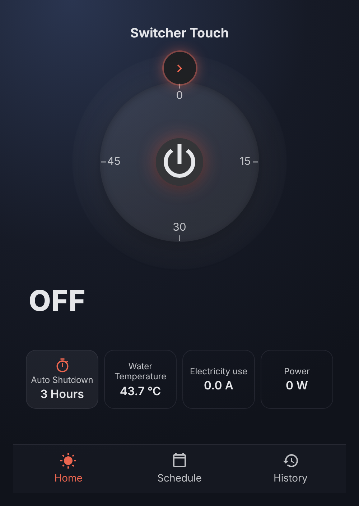
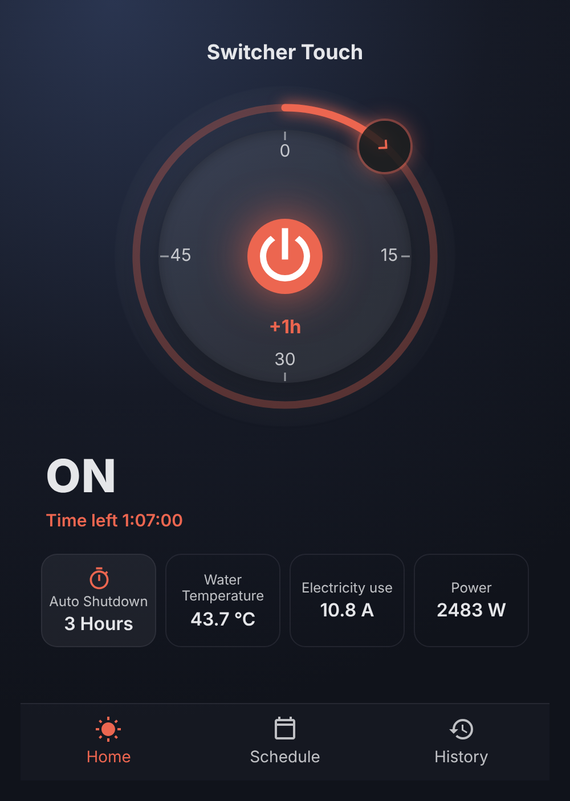
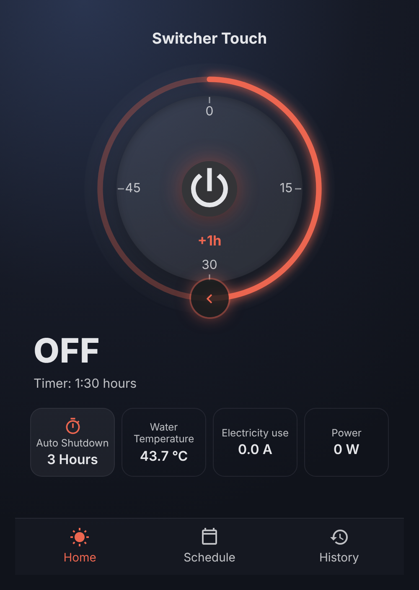
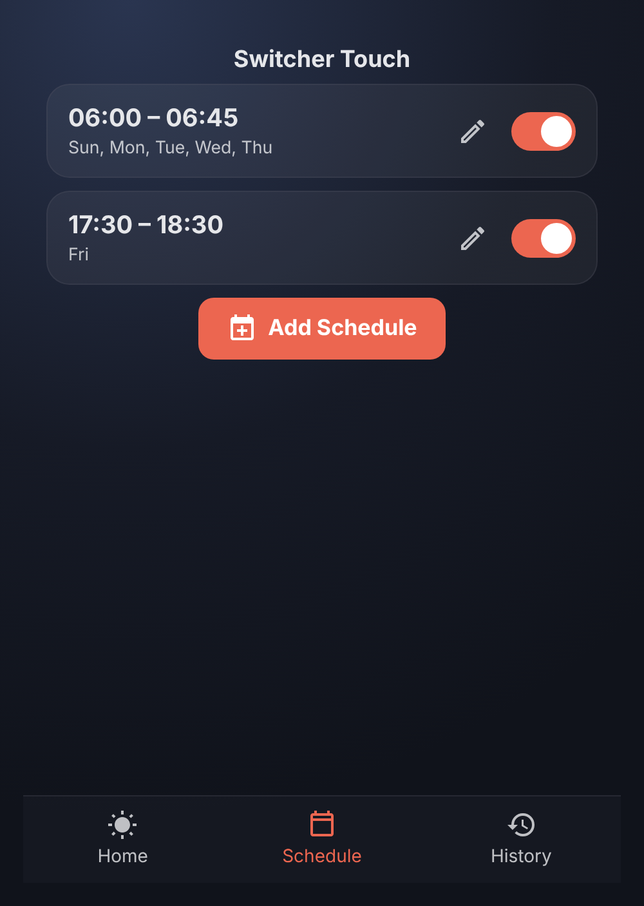
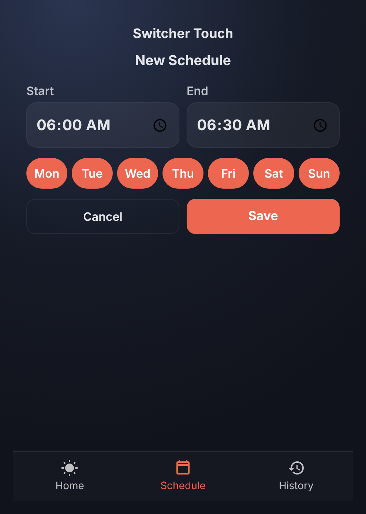
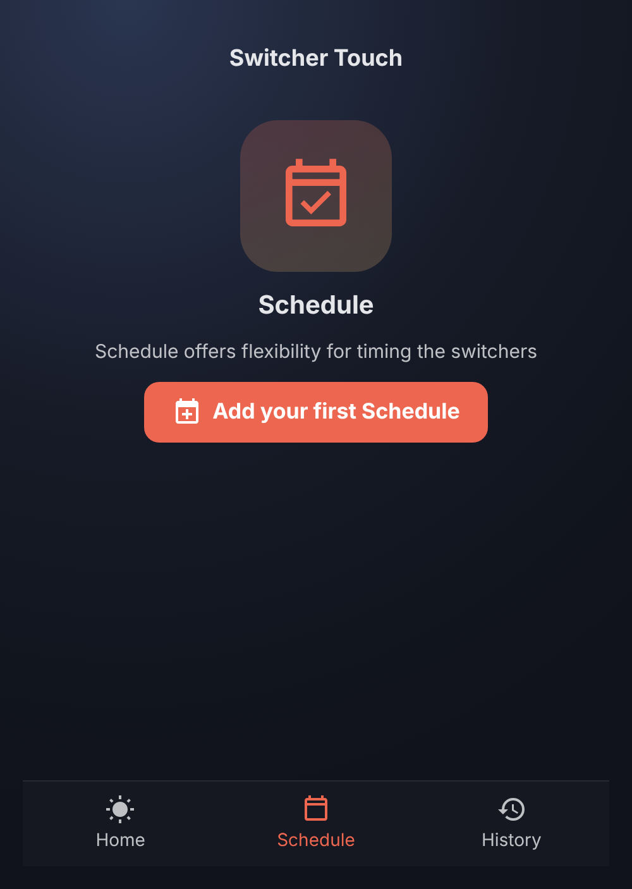
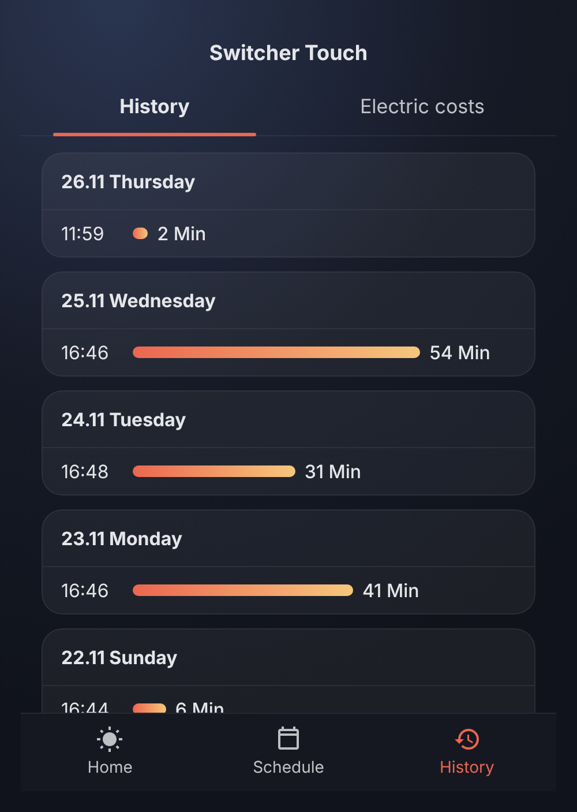
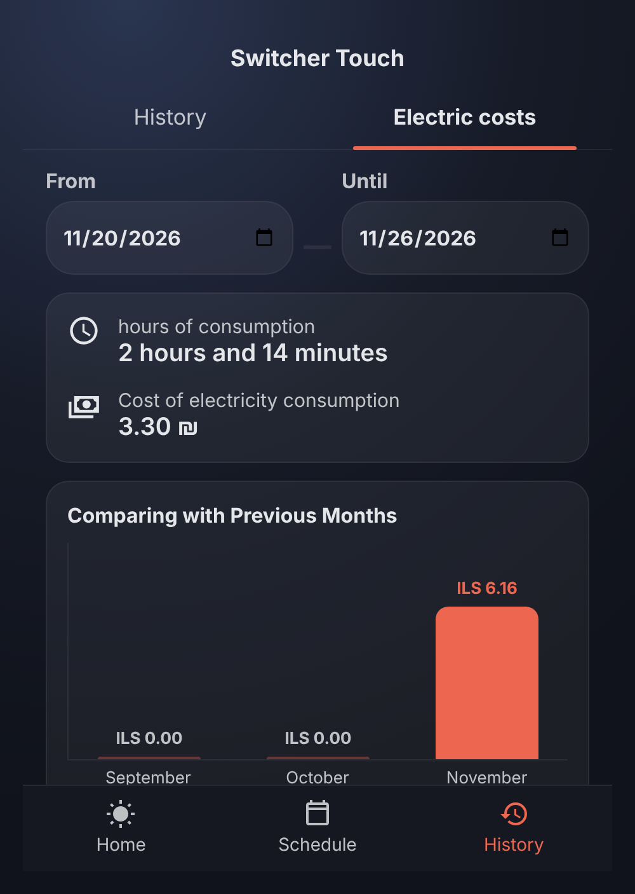

# Switcher Boiler Card

[](https://my.home-assistant.io/redirect/hacs_repository/?owner=matanmesika&repository=switcher-boiler-card&category=plugin)
[](https://github.com/matanmesika/switcher-boiler-card/releases/latest)

A Home Assistant dashboard card for a **Switcher water heater** (any boiler switch from the [Switcher integration](https://www.home-assistant.io/integrations/switcher_kis/), such as the Switcher Touch or V2). It brings the Switcher app's three screens, **Home**, **Schedule** and **History**, into your dashboard.

## Screenshots

Captured from the card with data from a real Home Assistant installation (Switcher Touch V2): sensors, run history and monthly energy. The running boiler, the 1:30 timer and the two schedules show what those screens look like.

### Home

| Off | Running | Timer over one hour |
| :---: | :---: | :---: |
|  |  |  |

### Schedule

| Schedules | New schedule | No schedules yet |
| :---: | :---: | :---: |
|  |  |  |

### History

| Runs | Electric costs |
| :---: | :---: |
|  |  |

## Features

- **Timer dial, like the app.** Drag the knob to set the time. One full turn is 60 minutes, and you can keep turning for longer runs. Completed turns stay on the dial as a faint ring with a **+1h / +2h** badge, and the knob's arrow points the way you're turning. While the boiler runs, the dial shows the time left. Letting go of the knob restarts the run with the new time.
- **Power button:** turns the boiler on for the chosen time, or off.
- **Info row:** Auto Shutdown (tap to change it on the device), water temperature, current and power. Tap any value for its history.
- **Schedule:** weekly schedules with start and end times and days. Add, edit, delete, and switch each one on or off.
- **History:** every run of the last 30 days, grouped by day, with a bar for its length.
- **Electric costs:** hours of use and cost for any date range, plus a month-by-month chart.
- **Fixed size:** each page has the same height and scrolls inside the card, so your dashboard doesn't jump.
- **Visual editor** for every option, and your theme's colors.

## Requirements

| What | Needed for | Notes |
| --- | --- | --- |
| [Switcher integration](https://www.home-assistant.io/integrations/switcher_kis/) (`switcher_kis`) | Everything | Built into Home Assistant. Gives the switch plus power, current, remaining time and auto shutdown sensors. |
| [Scheduler](https://github.com/nielsfaber/scheduler-component) integration (HACS) | Schedule page | The card saves schedules there, tagged `boiler`. Without it the Schedule page stays empty. |
| Recorder (on by default) | History page | Run history comes from the boiler switch's history. |
| An energy sensor with statistics | Electric costs | See [Energy and cost](#energy-and-cost). |
| A water temperature sensor | Water Temperature | Any sensor, for example a probe on the boiler. The Switcher doesn't measure it. |

## Installation

### HACS (recommended)

[](https://my.home-assistant.io/redirect/hacs_repository/?owner=matanmesika&repository=switcher-boiler-card&category=plugin)

1. Click the button above, or in **HACS → ⋮ → Custom repositories** add `https://github.com/matanmesika/switcher-boiler-card` with type **Dashboard**.
2. Find **Switcher Boiler Card** in HACS and choose **Download**.
3. Reload the browser (on the phone app: close and reopen it).

### Manual

Copy [`dist/switcher-boiler-card.js`](dist/switcher-boiler-card.js) to `<config>/www/`, then add `/local/switcher-boiler-card.js` as a **JavaScript module** under **Settings → Dashboards → ⋮ → Resources**.

## Setup

### Automatic

Add the card from the dashboard editor (**Add card → Switcher Boiler Card**). The editor picks your Switcher switch for you. In YAML, only the switch is needed:

```yaml
type: custom:switcher-boiler-card
entity: switch.boiler
```

With only `entity` set, the card:

- finds the **power**, **current**, **remaining time** and **auto shutdown** sensors of the same Switcher device;
- starts timed runs with the integration's own timer (`switcher_kis.turn_on_with_timer`, up to 150 minutes), so the Switcher turns itself off on time;
- saves each schedule so it starts the boiler with that same timer for the length of the slot;
- turns the boiler off with `switch.turn_off`.

Add `temperature` for the water temperature, and `energy` with `cost` or `price_per_kwh` for costs.

### Manual (visual editor or YAML)

Open the card's editor to choose every sensor, timer and script yourself. Anything you set by hand always replaces what the card detects. All options are in [examples/card-full.yaml](examples/card-full.yaml):

```yaml
type: custom:switcher-boiler-card
entity: switch.boiler
name: Switcher Touch
temperature: sensor.boiler_water_temperature
power: sensor.boiler_power
current: sensor.boiler_current
remaining: sensor.boiler_remaining_time
auto_shutdown: sensor.boiler_auto_shutdown
energy: sensor.boiler_energy_monthly
cost: sensor.boiler_cost_monthly
```

### Options

| Option | Default | Description |
| --- | --- | --- |
| `entity` | **required** | The Switcher boiler switch. |
| `name` | `Boiler` | Title at the top of the card. |
| `power` | detected | Power sensor (W). |
| `current` | detected | Current sensor (A). |
| `remaining` | detected | Remaining-time sensor (`HH:MM:SS`). Used when there's no `timer`. |
| `auto_shutdown` | detected | Auto-shutdown sensor (`HH:MM:SS`). Also sets the longest timer. |
| `temperature` | — | Water temperature sensor. The box is hidden without it. |
| `energy` | — | Energy sensor in kWh with long-term statistics, e.g. a monthly utility meter. Used for the monthly chart. |
| `energy_total` | `energy` | Total energy sensor, used for the cost of a date range. |
| `cost` | — | Cost sensor. The card divides cost by energy to get the price per kWh. |
| `price_per_kwh` | from `cost` / `energy` | Price per kWh. Overrides the calculated price. |
| `timer` | — | A `timer` helper that your scripts start. The dial shows its time left. |
| `run_script` | — | Script for timed runs. Receives `minutes`. Without it the card uses `switcher_kis.turn_on_with_timer`. |
| `off_script` | — | Script for the power button when the boiler is on. Without it: `switch.turn_off`. |
| `schedule_action` | Switcher timer for the slot length | Action a schedule runs at its start time (`service` + `service_data`). |
| `schedule_tag` | `boiler` | Scheduler tag for this boiler's schedules. Use a different tag for each boiler. |
| `dial_max` | `60` | Minutes per full turn of the dial. |
| `max_minutes` | Auto Shutdown | Longest timer. Without `run_script` it's at most 150 (the Switcher service limit). |
| `history_days` | `30` | Days shown on the History page. |
| `auto_off_options` | 1–12 hours | Choices in the Auto Shutdown list (`HH:MM`). |

Theme variables: `switcher-accent` (default `#ec6650`) and `switcher-height` (page height, default `560px`).

## Advanced: your own scripts and automations

Use scripts if your own automations should handle every run, for example to send notifications, block runs when the water is already hot, or allow runs longer than 150 minutes. [examples/helpers.yaml](examples/helpers.yaml) has everything ready to paste:

| Helper | What it does |
| --- | --- |
| `timer.boiler_timer` | Counts down the run. The card's dial follows it. |
| `script.boiler_run_timer` | Turns the boiler on and starts the timer for `minutes`. Set as `run_script`. |
| `script.boiler_off` | Turns the boiler off and cancels the timer. Set as `off_script`. |
| `script.boiler_scheduled_run` | Called by a schedule. Finds the slot that just started and runs until its end time. Set it in `schedule_action`. |
| Automation *Boiler - Timer end* | Turns the boiler off when the timer finishes, and cancels the timer when the boiler is turned off some other way. |

```yaml
type: custom:switcher-boiler-card
entity: switch.boiler
timer: timer.boiler_timer
run_script: script.boiler_run_timer
off_script: script.boiler_off
schedule_action:
  service: script.turn_on
  service_data:
    entity_id: script.boiler_scheduled_run
    variables:
      job_source: Scheduled
```

## Energy and cost

The Switcher reports power but not energy. To create energy and cost sensors (all in [examples/helpers.yaml](examples/helpers.yaml), or as helpers in the UI):

1. **Integral** helper from the power sensor → `sensor.boiler_energy` (kWh).
2. **Utility Meter** helper on it with a monthly cycle → `sensor.boiler_energy_monthly`.
3. Either set `price_per_kwh`, or add a template cost sensor and set `cost`.

Then set `energy: sensor.boiler_energy_monthly` (and optionally `energy_total: sensor.boiler_energy`). The chart fills in as statistics build up.

## Troubleshooting

- **The dial stops at 2:30:** without `run_script` the card uses the Switcher service, which accepts up to 150 minutes. Use the advanced setup for longer runs. The device still turns off after its Auto Shutdown.
- **The dial stops before you want:** the longest timer follows the device's Auto Shutdown. Raise it from the card, or set `max_minutes`.
- **The Schedule page is empty or won't save:** install the Scheduler integration and restart Home Assistant.
- **No costs:** `energy` needs a sensor with long-term statistics (`state_class: total` or `total_increasing`) and a price (`cost` or `price_per_kwh`).
- **An old version still shows after an update:** reload the browser, or close and reopen the phone app. The browser console shows the loaded version (`SWITCHER-BOILER-CARD v…`).

This is an unofficial project, not affiliated with Switcher.

## License

[MIT](LICENSE) © 2026 Matan Mesika

---

## עברית — בקצרה

כרטיס ל־Home Assistant לדוד חשמל של **Switcher**, עם שלושת המסכים של האפליקציה: **בית**, **תזמון** ו**היסטוריה**.

**התקנה:** HACS → Custom repositories → `https://github.com/matanmesika/switcher-boiler-card` (סוג Dashboard) → Download, ואז רענון הדפדפן.

**הגדרה אוטומטית:** בוחרים רק את מתג הדוד (`entity`). הכרטיס מוצא לבד את חיישני ההספק, הזרם, הזמן הנותר והכיבוי האוטומטי של אותו מכשיר. הוא מפעיל את הדוד עם הטיימר המובנה של Switcher (עד 150 דקות), כך שהדוד נכבה בזמן.

**הגדרה ידנית:** בעורך הוויזואלי בוחרים כל חיישן, טיימר וסקריפט בעצמכם: טמפרטורת מים, אנרגיה, עלות, מחיר לקוט"ש ועוד. מה שנבחר ידנית תמיד גובר על הזיהוי האוטומטי.

**החוגה:** כל סיבוב מלא הוא 60 דקות, ואפשר להמשיך לסובב. סיבובים שהושלמו נשארים כטבעת עמומה עם תווית ‎+1h / +2h. החץ מצביע לכיוון הסיבוב.

**נדרש:** האינטגרציה Switcher (מובנית). לדף התזמון צריך את Scheduler מ־HACS. לעלויות צריך חיישן אנרגיה עם סטטיסטיקה. דוגמאות מלאות לסקריפטים, טיימר, אוטומציה וחיישני אנרגיה ועלות נמצאות ב־[examples/helpers.yaml](examples/helpers.yaml).
